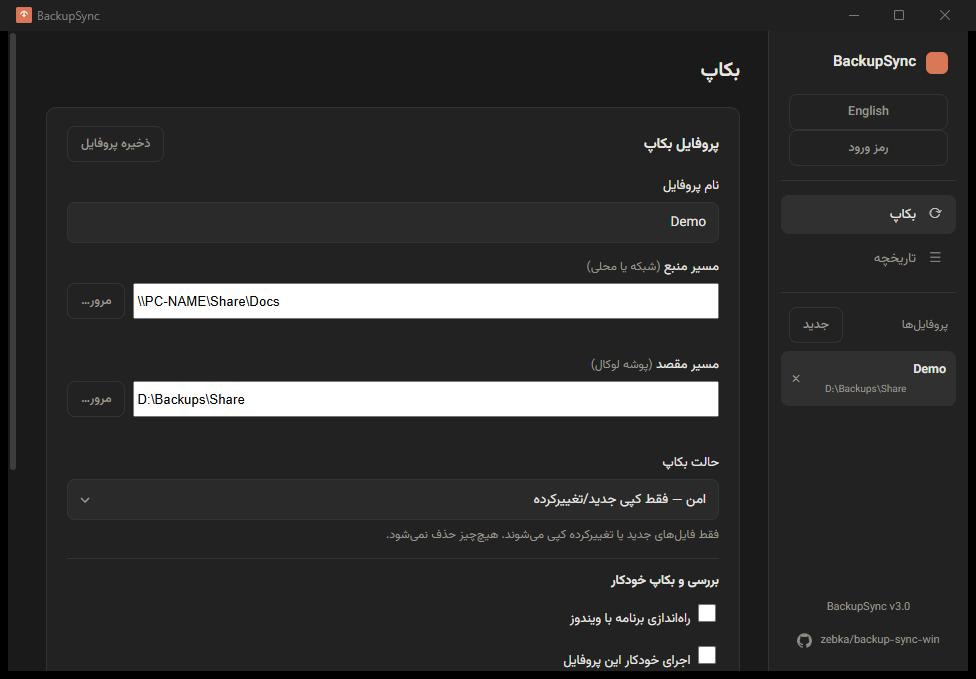

# BackupSync



یک نرم‌افزار متن‌باز و ساده برای **بکاپ ویندوز** و **بکاپ اشتراک شبکه**.
BackupSync روی **Robocopy** ساخته شده و رابط کاربری **فارسی راست‌به‌چپ** و **انگلیسی چپ‌به‌راست** دارد؛ از بکاپ افزایشی، پیش‌نمایش تغییرات، حالت آینه با `_Deleted` و زمان‌بندی روزانه/هفتگی پشتیبانی می‌کند.

English: [README.md](README.md)

## امکانات

- بکاپ افزایشی — فقط فایل‌های جدید/تغییرکرده کپی می‌شوند
- حالت امن و حالت آینه با `_Deleted` (فایل‌های حذف‌شده به سطل بازیافت منتقل می‌شوند)
- پیش‌نمایش قبل از بکاپ و لاگ زندهٔ اجرا
- تا سه پروفایل ذخیره‌شده
- بکاپ یا بررسی تغییرات به‌صورت روزانه/هفتگی
- بکاپ خودکار با هر بار روشن شدن ویندوز (به ازای هر پروفایل)
- رمز ورود اختیاری به برنامه همراه کد بازیابی تکدفعی (هش PBKDF2-SHA256؛ رمز بهصورت متن ساده ذخیره نمیشود)
- اجرای خودکار با ویندوز (Run key کاربر فعلی)
- رمز شبکه ذخیره نمیشود و فقط در حافظه میماند

## نیازمندی‌ها

- Windows 10/11
- WebView2 Runtime
- Rust (`x86_64-pc-windows-msvc`)
- Microsoft Visual Studio Build Tools با بارگذاری C++

## ساخت

```bash
git clone https://github.com/zebka/backup-sync-win.git
cd backup-sync-win
cargo tauri dev
cargo tauri build
```

نصب‌کننده:

```text
src-tauri\target\release\bundle\nsis\BackupSync_3.0.0_x64-setup.exe
```

## داده‌ها

`%APPDATA%\BackupSync\` — پروفایل‌ها، تاریخچه و لاگ‌ها این‌جا ذخیره می‌شوند.

## مجوز

MIT — [`LICENSE`](LICENSE).
