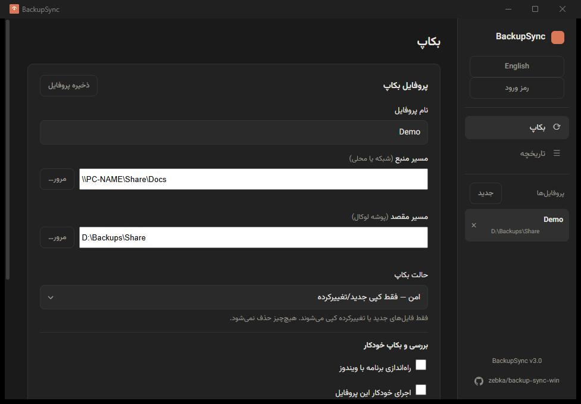

# BackupSync



A simple open-source **Windows backup app for network shares and local folders**.
It wraps **Robocopy**, keeps **Persian RTL / English LTR** UI, and supports **incremental backups**, change preview, mirror mode with `_Deleted`, and daily or weekly scheduling.

فارسی: [README.fa.md](README.fa.md)

## Features

- Incremental backup — copy only new or changed files
- Safe mode and mirror mode with `_Deleted` recycle protection
- Preview before backup and live run log
- Up to three saved profiles
- Daily / weekly scheduled backup or check-only run
- Backup on every Windows startup (per profile)
- Optional app password with a one-time recovery code (PBKDF2-SHA256, never stored in plain text)
- Optional Windows startup via current-user Run key
- Network passwords are never stored — kept only in memory

## Requirements

- Windows 10/11
- WebView2 Runtime
- Rust (`x86_64-pc-windows-msvc`)
- Microsoft Visual Studio Build Tools with C++ workload

## Build

```bash
git clone https://github.com/zebka/backup-sync-win.git
cd backup-sync-win
cargo tauri dev
cargo tauri build
```

Installer:

```text
src-tauri\target\release\bundle\nsis\BackupSync_3.0.0_x64-setup.exe
```

## Data

`%APPDATA%\BackupSync\` — profiles, history, and logs live here.

## License

MIT — see [`LICENSE`](LICENSE).
